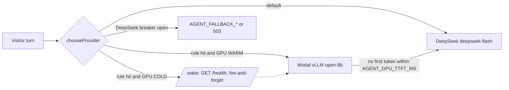

# GPU tier (self-hosted open model)

An optional second inference tier for the site agent: **vLLM** serving
**Qwen3-8B** (exposed as `open-8b`) behind an **OpenAI-compatible** API on
**Modal**, scaled to zero when idle. DeepSeek (`deepseek-flash`, thinking off)
stays the default for every visitor; the GPU only answers when a rule below
picks it **and** it is already warm.

Merging this code costs nothing. The tier is **off** until you set
`AGENT_GPU_MODE` plus a base URL and key in Vercel. Nothing in this folder
is deployed automatically.



## Guarantees

- **Never blocks a visitor on a cold GPU.** A cold GPU gets a background wake
  (deduplicated across instances with a KV lease) and the turn goes to DeepSeek.
- **Switches only before the first token.** If the GPU returns an error or no
  token within `AGENT_GPU_TTFT_MS`, the turn is re-run on DeepSeek before any
  byte is streamed. After the first token, the turn stays on that provider.
- **Roots stay sticky.** A conversation root keeps its provider (the frozen
  system prefix names the speaking model). If a GPU root's GPU is gone, the
  client gets the existing `409 model_swap` and resends on a fresh root.
- **Per-provider breakers.** The GPU has its own `breaker:v1:gpu:*` circuit.
- **Shared state** (lifecycle, wake lease, spend, router stats) lives in
  Upstash Redis when `UPSTASH_REDIS_REST_*` / `KV_REST_API_*` is set, and falls
  back to per-instance memory otherwise.

## Lifecycle

`COLD → WARMING → WARM → (DRAINING)`, stored at `gpu:v1:state`.

- **wake**: `GET AGENT_GPU_HEALTH_URL` (Modal's proxy returns 503 and starts a
  replica). Sets `WARMING`.
- **probe**: every chat request fires a background health probe (lease 10 s).
  200 → `WARM` (TTL 45 s, refreshed by probes and successful GPU turns);
  `WARMING` longer than `AGENT_GPU_STARTUP_TIMEOUT_S` → `COLD`.
- **drain**: owner-only; stops new GPU picks for 15 min while sticky roots
  fail over through `model_swap`.

Owner controls live at `/agent-analytics` (GPU router panel) and
`GET/POST /api/agent/gpu` (`{"action":"wake"|"probe"|"drain"|"undrain"}`).

## Phases and env vars (Vercel, Production)

| Phase | What turns on | Set |
|---|---|---|
| 0 | `deepseek-flash`, shared breaker/quota state, signed quota cookie | `UPSTASH_REDIS_REST_URL` + `UPSTASH_REDIS_REST_TOKEN` (or the `KV_REST_API_*` pair the Vercel integration adds), `CHAT_QUOTA_SECRET`. Optional `DEEPSEEK_MODEL` (default `deepseek-flash`; auto-falls back to `deepseek-chat` for 1 h if the id is rejected). |
| 1a | Owner-only GPU: your own chats can pick the GPU from the analytics panel | `AGENT_GPU_MODE=owner`, `AGENT_GPU_BASE_URL` (`https://…modal.direct/v1`), `AGENT_GPU_API_KEY` (same value as the Modal secret) |
| 1b | Visitor rules (each one independently, all off by default) | `AGENT_GPU_MODE=public`, then any of: `AGENT_GPU_FAILOVER=1` (GPU when DeepSeek's breaker is open), `AGENT_GPU_SPILL_INFLIGHT=<n>` (GPU when ≥ n DeepSeek turns are in flight), `AGENT_GPU_SPILL_TTFT_MS=<ms>` (GPU after 3 slow DeepSeek first tokens within about two minutes), `AGENT_GPU_DEEPSEEK_DAILY_BUDGET_USD=<usd>` (GPU after today's estimated DeepSeek spend passes this), `AGENT_GPU_CANARY_PCT=<0-100>` (share of new roots), `AGENT_GPU_ROUTES=<route,route>` (limit visitor rules to these tool routes) |

Optional tuning: `AGENT_GPU_MODEL` (default `open-8b`), `AGENT_GPU_PROVIDER_ID`
(default `gpu:open-8b`; always `gpu:`-prefixed and never contains `qwen`),
`AGENT_GPU_MAX_CONTEXT` (default 32768; longer prompts stay on DeepSeek),
`AGENT_GPU_TTFT_MS` (default 8000), `AGENT_GPU_HEALTH_URL` (default: base URL
without `/v1` plus `/health`), `AGENT_GPU_STARTUP_TIMEOUT_S` (default 600),
`AGENT_GPU_THINKING=1` (default off).

Visitor rules never apply to the Shanghai voice, and never to a root already
locked to DeepSeek. Turn everything off again with `AGENT_GPU_MODE=off`.

## Deploy (you run this; it is never run by CI)

```bash
pip install modal && modal setup                 # once, your Modal account
modal secret create aileena-gpu-key VLLM_API_KEY="$(openssl rand -hex 32)"
cd aileena-new
modal deploy infra/gpu/vllm_server.py            # prints the server URL
modal run infra/gpu/vllm_server.py               # optional smoke test (~1 GPU-minute)
```

Then in Vercel set `AGENT_GPU_BASE_URL=<printed URL>/v1`,
`AGENT_GPU_API_KEY=<the same key>` and `AGENT_GPU_MODE=owner`.

Deploy-time knobs (environment of the shell running `modal deploy`):

| Variable | Default | Notes |
|---|---|---|
| `AILEENA_GPU_TYPE` | `L40S` | 48 GB. `A10`/`L4` (24 GB) are cheaper; pair them with `AILEENA_GPU_QUANT=awq` or `fp8` (L4 only) |
| `AILEENA_GPU_QUANT` | none | `fp8` (Ada/Hopper: L40S, L4, H100) or `awq` (uses `Qwen/Qwen3-8B-AWQ`) |
| `AILEENA_GPU_SPEC` | none | Speculative decoding: `ngram` (free, good for quoting the prompt) or `draft` (`Qwen/Qwen3-0.6B`) |
| `AILEENA_GPU_MAX_LEN` | `32768` | Keep in sync with `AGENT_GPU_MAX_CONTEXT` |
| `AILEENA_GPU_MAX_SEQS` | `32` | Concurrent sequences per replica |
| `AILEENA_GPU_SCALEDOWN_S` | `300` | Idle seconds before scale-to-zero |
| `AILEENA_GPU_FAST_BOOT` | `1` | `--enforce-eager`: faster cold start, slower decode. Set `0` if you keep it warm |
| `AILEENA_GPU_REGION` | `us-east` | Vercel functions run in `iad1` |
| `AILEENA_GPU_KEEP_WARM_UTC` | off | e.g. `1-15` keeps one replica warm 01:00–15:00 UTC (09:00–23:00 Shanghai) via a 15-min cron |
| `AILEENA_GPU_REVISION` | `main` | Pin a commit hash for reproducible deploys |

Serving flags always on: `--enable-prefix-caching` (the site's frozen system
prefix is byte-stable per root, so follow-up turns are mostly cached),
`--enable-chunked-prefill`, `--enable-prompt-tokens-details` (cache hits show
up in the analytics), hermes tool calling, and `--api-key` (the container
refuses to start without `VLLM_API_KEY`). Modal's proxy auth is disabled so
the site can use a plain Bearer token; `/health` is open so wakes need no key.

## Cost (Modal list prices, October 2026)

| GPU | $/s | $/hour up |
|---|---|---|
| L40S | 0.000542 | ≈ 1.95 |
| A10 | 0.000306 | ≈ 1.10 |
| L4 | 0.000222 | ≈ 0.80 |

You pay only while a replica is up: each wake costs cold start
(≈ 1–3 min) plus `AILEENA_GPU_SCALEDOWN_S` idle time, so one isolated owner
wake on an L40S is about $0.15–0.25. `max_containers=2` caps runaway scale.
Modal's Starter plan includes $30/month of credit. For comparison,
`deepseek-flash` is $0.15–0.30 per 1M uncached input tokens and $0.60–1.20
per 1M output tokens, so the GPU tier is about resilience and control,
not saving money at low traffic.

## Measuring optimisations

The owner page **/agent-analytics/performance** records every chat turn
(TTFT, latency, tokens, prefix-cache hits, estimated cost). The server also
serves the alias `open-8b.<variant>` (e.g. `open-8b.fp8-ngram`, `open-8b.base-eager`);
the site reads it from `/v1/models` and the **Compare** tab splits GPU turns by
variant. Override with `AGENT_GPU_VARIANT`. GPU turn cost uses `AGENT_GPU_TYPE`
(default `L40S`) or `AGENT_GPU_USD_PER_HOUR`.

To compare variants: deploy one, run `pnpm bench:inference --tier gpu --run fp8`
(see `scripts/bench-inference.ts`), redeploy with other knobs, run again.

## Bench

```bash
AGENT_GPU_BASE_URL=… AGENT_GPU_API_KEY=… python infra/gpu/bench.py --n 12 --concurrency 4
```

Prints TTFT p50/p95, decode tokens/s, and cached prompt tokens.

## Tests

`pnpm harness:site-agent:gpu` runs the offline router suite against a local
mock (no GPU, no network, no keys). It is part of CI.
